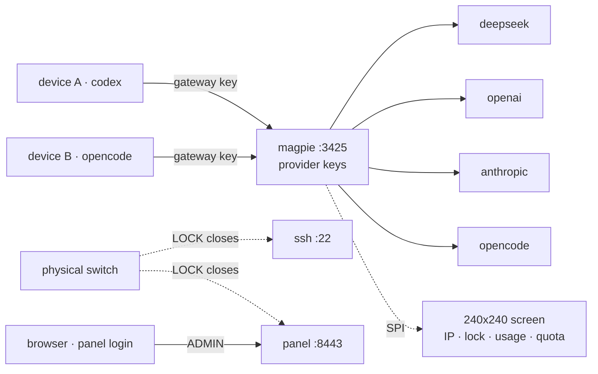

**English** · [简体中文](./README.zh-CN.md)

# NoKeyOut

**open-source standalone key box**

A small box that locks API key access with a **physical switch**.

Standalone hardware and a physical switch block accidental or malicious agent access to API keys.

NoKeyOut is a small ARM64 device on your LAN: provider API keys live on it, a physical switch closes SSH and the panel, and a 240x240 screen reports state locally.



## Three things the box does

- **Keys on the box.** Provider keys live only on the device. Clients get gateway keys, revocable per machine.
- **Physical lock.** The switch closes SSH and the panel.
- **Local screen.** 240x240: IP, lock state, usage, quota.

## Install

Reference build: NanoPi NEO3 Plus. Any 256 MB ARM64 board runs it headless.

| Part | Qty | Spec | Cost |
|---|---|---|---|
| NanoPi NEO3 Plus | 1 | RK3528A · 1GB · GbE · eMMC/microSD · 26-pin header | ¥179 / $26.85 |
| Slide switch | 1 | 2-position latching | ¥0.80 / $0.12 |
| Jumper wires | 10 | female-female | ¥1.05 / $0.16 |
| ST7789 display | 1 | 1.3 or 1.54 in · 240x240 · SPI · header pre-soldered | ¥24.70 / $3.71 |
| USB-C power | 1 | 5V / 3A or more | ¥32.80 / $4.92 |
| TF card | 1 | ≥16GB · Class 10 or faster | ¥86.90 / $13.04 |
| USB card reader | 1 | USB-A or USB-C | — |
| Ethernet cable | 1 | 100M or faster (Cat5 or better) | — |
| **Total** | | priced parts only | **¥325.25 / $48.80** |

Reference prices, ¥1 = $0.15.

[Build one](https://nokeyout.com/diy/)

Flash the card:

```bash
# Linux (root)
sudo bash tools/install-tf.sh --board neo3plus
```

```powershell
# Windows 10/11 (Administrator)
powershell -ExecutionPolicy Bypass -File .\tools\install-tf.ps1 -Board neo3plus
```

With WSL2 available, the Windows script also creates the `nokeyout` user, enables SSH, and injects a one-shot first-boot installer, so NoKeyOut installs automatically on first boot (internet required). Without WSL2 it writes the Armbian image only; after the board's first login, run:

```bash
curl -fsSL https://nokeyout.com/tools/install-nokeyout.sh | sudo sh
```

## Repository

| Path | Contents |
|---|---|
| `device/gateway/` | magpie deployment, version pinning, upgrade/rollback scripts, root helpers |
| `device/panel-go/` | Panel in Go: login/session, switch gate, console proxy, model tools, statistics, first-boot flow, screen renderer |
| `device/panel/web/` | Management panel pages |
| `device/update/` | Signed release client and manifest verification |
| `device/image/` | Buildroot/image assembly and first-boot scripts |
| `omp-provider/` | omp / Pi provider extension that reads `/v1/models` |
| `web/` | Website: homepage + 404 at the root, 3D assembly walkthrough under `diy/` |

## Build

Go 1.22 or newer, a C compiler, and PAM development files for `nokeyout-auth`.

```bash
./device/panel-go/build.sh
./device/update/build.sh
./device/gateway/build-auth.sh
./device/release.sh <version>      # release archive
```

Binaries are not committed; build them from source.

## Deploy

```bash
sudo ./device/panel/setup.sh --ip <device-ip> --port 8443
```

The setup script installs the Go panel, a systemd unit, a self-signed certificate, and the sudoers entries used by the PAM, magpie CLI, upgrade, and update helpers.

| Port | Service |
|---|---|
| `8443` | Management panel |
| `3425` | Gateway (magpie) |
| `3430` | magpie web UI, bound to loopback |

## License

MIT. See `LICENSE`.

Gateway engine: [yetone/magpie](https://github.com/yetone/magpie) (MIT).
