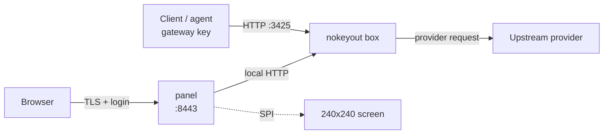

**English** · [简体中文](./README.zh-CN.md)

# NoKeyOut

NoKeyOut is a standalone ARM64 device that keeps your provider API keys on your LAN.

Three things define the device:

- **Keys live on it.** Provider credentials stay on the device's own storage; laptops and agents never hold them, only a gateway key that can be revoked per machine.
- **A physical switch closes the management port.** Locked, the panel on `:8443` stops serving and browsers logged in earlier are signed out. Client agents keep calling `:3425`. There is no remote unlock path: reopening it takes hands on the device.
- **A 240x240 screen is the local channel.** It shows IP and lock state, usage and quota, first boot and no-keys states — without asking the network.

The gateway engine is [magpie](https://github.com/yetone/magpie) by yetone, used unmodified. This repository is the device around it: panel, screen renderer, switch gate, updater, image and setup scripts.



## Components

| Component | Description |
|---|---|
| `device/gateway/` | magpie deployment, version pinning, upgrade/rollback scripts, root helpers |
| `device/panel-go/` | Panel in Go: login/session, switch gate, console proxy, model tools, statistics, first-boot flow, screen renderer |
| `device/panel/web/` | Management panel pages |
| `device/update/` | Signed release client and manifest verification |
| `device/image/` | Buildroot/image assembly and first-boot scripts |
| `omp-provider/` | omp / Pi provider extension that reads `/v1/models` |
| `web/` | Website: homepage + 404 at the root, 3D assembly walkthrough under `diy/` |

## How it works

1. Provider credentials are stored on the device.
2. The panel runs on `:8443`; the physical switch gates it. Locked closes the listener (file backend: a locked page) and signs out browsers already logged in. The gateway on `:3425` keeps serving clients.
3. Clients use a gateway key against `/v1/models` and the chat endpoints on `:3425`. The gateway engine is magpie, unmodified.
4. The screen shows IP, lock state, usage and quota.

## Requirements

- ARM64 Linux device (the reference hardware is a NanoPi NEO3 Plus)
- Go 1.22 or newer for the panel, updater, and mock gateway
- A C compiler and PAM development files for `nokeyout-auth`
- magpie, used unmodified as the gateway engine (binary or container); the repository does not modify magpie
- Optional: ST7789 240x240 SPI display, GPIO switch, LUKS volume, Node/npm for magpie plugins

## Build

```bash
./device/panel-go/build.sh
./device/update/build.sh
./device/gateway/build-auth.sh
```

Create a release archive:

```bash
./device/release.sh <version>
```

Binaries are not committed to the repository; build them from source.

## Deploy

```bash
sudo ./device/panel/setup.sh --ip <device-ip> --port 8443
```

The setup script installs:

- the Go panel under `/var/lib/nokeyout/app/`
- a systemd unit for the panel
- a self-signed server certificate
- sudoers entries for the PAM, magpie CLI, upgrade, and update helpers

Default ports:

| Port | Service |
|---|---|
| `8443` | Management panel |
| `3425` | Gateway (magpie) |
| `3430` | magpie web UI, bound to loopback |

## Management panel

The panel provides:

- device and gateway status
- usage totals and quotas
- model list and client configuration generation
- gateway key selection
- first-boot setup
- backup, upgrade, and rollback controls
- signed NoKeyOut update controls
- screen module configuration
- onboard USER button action (screen off/on by default; MASK is left to recovery)
- screen hold while the management port is open: ADMIN shows an open timer and flashes after 15 minutes; the USER button cannot turn the screen off until the switch returns to LOCK

Login uses the device's PAM account. The panel runs as the `nokeyout` user; privileged operations call the installed helpers through sudoers.

## Client configuration

The panel generates client configuration for `omp`, Codex, Claude Code, environment variables, OpenCode, Crush, Continue, Aider, Qwen Code, Zed, Cline, Roo Code, and Kilo Code. File-based clients show their target path under the generated snippet; the list lives once in `device/panel-go/agents.go`.

For the omp provider extension:

```bash
omp plugin install git:https://nokeyout.com/omp-provider
```

The generated configuration has this form:

```json
{
  "baseUrl": "http://<device-ip>:3425/v1",
  "gatewayKey": "sk-...",
  "providerId": "nokeyout"
}
```

The extension loads the configuration from `~/.omp/agent/nokeyout-provider.json`. The model list is fetched from `GET /v1/models`; `/nokeyout-refresh` reloads it during a session.

## Upgrades

NoKeyOut releases use a signed manifest:

```bash
nokeyout-update check
nokeyout-update install
nokeyout-update rollback
```

magpie updates are separate:

```bash
sudo /usr/local/bin/nokeyout-upgrade upgrade <version>
```

## License

MIT. See `LICENSE`.

magpie is a separate project by yetone, distributed under the MIT license:
https://github.com/yetone/magpie
