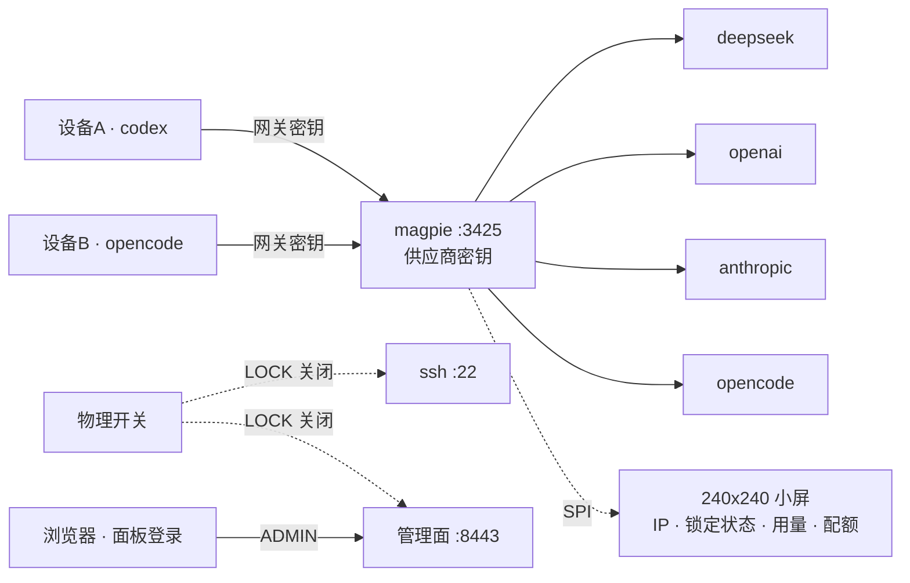

[English](./README.md) · **简体中文**

# NoKeyOut

**开源独立的密钥设备**

一个小盒子，用**物理开关**锁定 apikey 访问权限。

用独立硬件和物理开关阻断 agent 对 apikey 的意外/恶意访问。

NoKeyOut 是局域网上一台 ARM64 小设备：供应商 API 密钥只存在它上面，物理开关关闭 SSH 与管理面，240x240 小屏在本地显示状态。



## 这台盒子做的三件事

- **密钥在盒子里。** 供应商密钥只存在设备上。客户端只拿得到可逐台吊销的网关密钥。
- **物理锁。** 开关同时关闭 SSH 与管理面。
- **本地小屏。** 240x240：IP、锁定状态、用量与配额。

## 安装

参考配置：NanoPi NEO3 Plus；任何 256 MB 的 ARM64 板子都能无头运行。

| 件 | 数量 | 规格 | 价格 |
|---|---|---|---|
| NanoPi NEO3 Plus | 1 | RK3528A · 1GB · 千兆网口 · eMMC/microSD · 26-pin 2.54mm 排针 | ¥179 / $26.85 |
| 拨动开关 | 1 | 锁存 2 档 | ¥0.80 / $0.12 |
| 杜邦线 | 10 | 母-母 | ¥1.05 / $0.16 |
| ST7789 屏模块 | 1 | 1.3 或 1.54 英寸 · 240×240 · SPI · 排针已焊 | ¥24.70 / $3.71 |
| USB-C 电源 | 1 | 5V / 3A 及以上 | ¥32.80 / $4.92 |
| TF 卡 | 1 | ≥16GB · Class 10 及以上 | ¥86.90 / $13.04 |
| USB 读卡器 | 1 | USB-A 或 USB-C 接口 | — |
| 网线 | 1 | 百兆及以上（Cat5 或更好） | — |
| **合计** | | 仅计价件 | **¥325.25 / $48.80** |

参考价，¥1 = $0.15。

[开始组装](https://nokeyout.com/diy/)

烧录 TF 卡：

```bash
# Linux（root）
sudo bash tools/install-tf.sh --board neo3plus
```

```powershell
# Windows 10/11（管理员）
powershell -ExecutionPolicy Bypass -File .\tools\install-tf.ps1 -Board neo3plus
```

发行包在烧录时下载，不在首次启动时下载。有 WSL2 时，Windows 脚本还会创建 `nokeyout` 用户、启用 SSH，并把这份签名发行包写入卡内；首次启动离线安装同一版本。没有 WSL2 时加 `-NoDeploy` 只写入 Armbian 镜像，板子首次登录后再执行：

```bash
curl -fsSL https://nokeyout.com/tools/install-nokeyout.sh | sudo sh
```

下载会缓存并支持续传。Linux 使用 `~/.cache/nokeyout-images` 与 `~/.cache/nokeyout-releases`（可用 `NOKEYOUT_CACHE` 覆盖）；Windows 使用 `%LOCALAPPDATA%\nokeyout\cache`。两个平台都可用 `NOKEYOUT_CACHE` 覆盖缓存根目录。已有文件只有通过 SHA-256 校验才会复用；中断的 `.part` 会用 `curl -C -` / `wget -c` 续传。删除缓存目录即可强制重新下载。

## 仓库

| 路径 | 内容 |
|---|---|
| `device/gateway/` | magpie 部署、版本锁定、升级/回滚脚本、root helper |
| `device/panel-go/` | Go 管理面：登录/会话、开关门控、控制台代理、模型工具、统计、首启流程、屏幕渲染 |
| `device/panel/web/` | 管理面页面 |
| `device/update/` | 签名发布客户端与 manifest 校验 |
| `device/image/` | Buildroot/镜像组装与首启脚本 |
| `omp-provider/` | omp / Pi provider 扩展，从 `/v1/models` 读取模型列表 |
| `web/` | 网站：根目录是主页与 404 页，`diy/` 下是 3D 装配演练 |

## 构建

需要 Go 1.22+、C 编译器，以及 `nokeyout-auth` 所需的 PAM 开发文件。

```bash
./device/panel-go/build.sh
./device/update/build.sh
./device/gateway/build-auth.sh
./device/release.sh <version>      # 发布归档
```

二进制不提交到仓库，请从源码构建。

## 部署

```bash
sudo ./device/panel/setup.sh --ip <device-ip> --port 8443
```

安装脚本会安装 Go 管理面、systemd 单元、自签证书，以及 PAM、magpie CLI、升级与更新 helper 所需的 sudoers 条目。

| 端口 | 服务 |
|---|---|
| `8443` | 管理面 |
| `3425` | 网关（magpie） |
| `3430` | magpie web UI，仅绑回环 |

要烧录指定版本，把 `NOKEYOUT_RELEASE_URL` 指向该版本的 `manifest.json`（`NOKEYOUT_RELEASE_URL=... sudo bash tools/install-tf.sh --board neo3plus`）。

## 更新

更新是手动动作：在管理面「系统」页使用签名更新按钮，或执行：

```bash
nokeyout-update check
nokeyout-update install
nokeyout-update rollback
```

烧录时写入的发行包是初始基线；首次启动只安装这个版本，不会联网拉取或自动升级。

## License

MIT，见 `LICENSE`。

网关引擎：[yetone/magpie](https://github.com/yetone/magpie)（MIT）。
