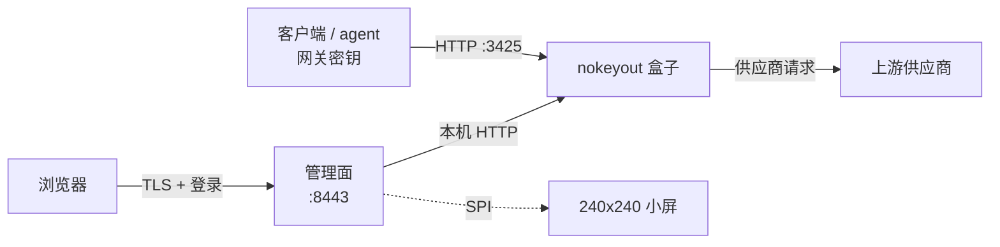

[English](./README.md) · **简体中文**

# NoKeyOut

NoKeyOut 是一块独立运行在局域网里的 ARM64 设备，保管你的供应商 API 密钥。

三点定义这台设备：

- **密钥就在设备上。** 供应商凭据保存在设备自身的存储里，笔记本和 agent 都不持有，只拿一个可逐台吊销的网关密钥。
- **物理开关关闭管理端口。** 锁定后 `:8443` 的管理面停止服务，之前登录的浏览器被登出；客户端 agent 仍照常调用 `:3425`。没有远程解锁通道，要重新打开只能到设备跟前。
- **240x240 小屏是本地通道。** 不依赖网络就显示 IP 与锁定状态、用量与配额、首次启动与无密钥状态。

网关引擎是 yetone 的 [magpie](https://github.com/yetone/magpie)，未做任何修改。本仓库是它外面的设备：管理面、屏幕渲染、开关门控、更新器、镜像与安装脚本。



## 组件

| 组件 | 说明 |
|---|---|
| `device/gateway/` | magpie 部署、版本锁定、升级/回滚脚本、root helper |
| `device/panel-go/` | Go 管理面：登录/会话、开关门控、控制台代理、模型工具、统计、首启流程、屏幕渲染 |
| `device/panel/web/` | 管理面页面 |
| `device/update/` | 签名发布客户端与 manifest 校验 |
| `device/image/` | Buildroot/镜像组装与首启脚本 |
| `omp-provider/` | omp / Pi provider 扩展，从 `/v1/models` 读取模型列表 |
| `web/` | 网站：根目录是主页与 404 页，`diy/` 下是 3D 装配演练 |

## 工作方式

1. 供应商凭据保存在设备上。
2. 管理面在 `:8443`，由物理开关门控：锁定即关闭监听（文件后端返回锁定页），并让已登录的浏览器失效；`:3425` 继续服务客户端。
3. 客户端用网关密钥访问 `:3425` 的 `/v1/models` 与聊天接口；网关引擎是未修改的 magpie。
4. 屏幕显示 IP、锁定状态、用量与配额。

## 环境要求

- ARM64 Linux 设备（参考硬件为 NanoPi NEO3 Plus）
- Go 1.22 或更高版本，用于管理面、更新器和 mock 网关
- C 编译器与 PAM 开发文件，用于 `nokeyout-auth`
- magpie，作为未修改的网关引擎（二进制或容器）；本仓库不修改 magpie
- 可选：ST7789 240x240 SPI 屏幕、GPIO 开关、LUKS 数据卷、用于 magpie 插件的 Node/npm

## 构建

```bash
./device/panel-go/build.sh
./device/update/build.sh
./device/gateway/build-auth.sh
```

生成发布包：

```bash
./device/release.sh <version>
```

仓库不提交二进制文件，需要从源码构建。

## 部署

```bash
sudo ./device/panel/setup.sh --ip <device-ip> --port 8443
```

安装脚本会安装：

- `/var/lib/nokeyout/app/` 下的 Go 管理面
- 管理面的 systemd unit
- 自签服务端证书
- PAM、magpie CLI、升级与更新 helper 的 sudoers 条目

默认端口：

| 端口 | 服务 |
|---|---|
| `8443` | 管理面 |
| `3425` | 网关（magpie） |
| `3430` | magpie web UI，绑定回环地址 |

## 管理面

管理面提供：

- 设备与网关状态
- 用量统计与额度
- 模型列表与客户端配置生成
- 网关密钥选择
- 首启设置
- 备份、升级与回滚
- NoKeyOut 签名更新
- 屏幕模块配置
- 板载 USER 按键动作（默认熄屏/亮屏）
- 端口开放期间屏幕常亮：ADMIN 页显示开放计时，超过 15 分钟闪烁；拨回 LOCK 前 USER 键不能熄屏

登录使用设备的 PAM 账号。管理面以 `nokeyout` 用户运行；特权操作通过 sudoers 调用已安装的 helper。

## 客户端配置

管理面可为 `omp`、Codex、Claude Code、环境变量、OpenCode、Crush、Continue、Aider、Qwen Code、Zed、Cline、Roo Code 和 Kilo Code 生成客户端配置。文件型客户端会在生成结果下显示目标路径；清单只在 `device/panel-go/agents.go` 维护一次。

omp provider 扩展：

```bash
omp plugin install git:https://nokeyout.com/omp-provider
```

生成的配置格式：

```json
{
  "baseUrl": "http://<device-ip>:3425/v1",
  "gatewayKey": "sk-...",
  "providerId": "nokeyout"
}
```

扩展从 `~/.omp/agent/nokeyout-provider.json` 读取配置，并通过 `GET /v1/models` 拉取模型列表；会话内可用 `/nokeyout-refresh` 重新拉取。

## 升级

NoKeyOut 发布使用签名 manifest：

```bash
nokeyout-update check
nokeyout-update install
nokeyout-update rollback
```

magpie 更新独立执行：

```bash
sudo /usr/local/bin/nokeyout-upgrade upgrade <version>
```

## License

MIT，见 `LICENSE`。

magpie 是 yetone 的独立项目，同样以 MIT 许可证发布：
https://github.com/yetone/magpie
